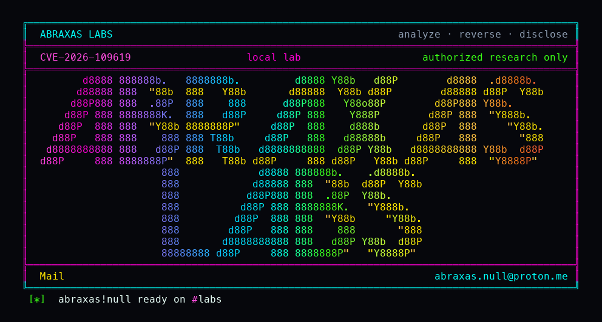

<p align="center">
  
</p>

# php-stale-global-uaf

Someone on the internet can talk to your PHP site the same way a browser does, with no password. On last-affected PHP 8.5 they can force one request to die with a fatal error, then send a second request to the same worker. PHP 8.5 keeps a backtrace from that fatal in worker-global memory after the request heap is gone. The second request reads it while applying a leftover INI flag, before the engine has reset itself. In this lab that second request kills the Apache child. The PHP Group showed the same pattern can become remote code execution as the web worker.

**Class:** UAF / Crash
**Reach:** Remote

**PHP** 8.5.11 (`php:8.5.11-apache`) vs patched 8.5.12 - [php.net](https://www.php.net/archive/2026.php#2026-10-21-5)

CVE-2026-109619 is stale worker-global state. The lab pins Apache prefork to one child, produces a fatal with `fatal_error_backtraces=On`, then consumes it with per-dir `php_flag auto_detect_line_endings on` / `report_memleaks off` applied before `php_request_startup()`. 8.5.11: producer 200 fatal, consumer connection reset, Apache log `zend_mm_heap corrupted`. 8.5.12: the same two-phase stays up (`consumer-ok`). Advisory RCE as the Apache worker is inferred from the GHSA.

| | |
|---|---|
| ID | [CVE-2026-109619](https://www.cve.org/CVERecord?id=CVE-2026-109619) |
| Advisory | [GHSA-6wmf-4rv5-p3rp](https://github.com/php/php-src/security/advisories/GHSA-6wmf-4rv5-p3rp) |
| Class | **UAF / Crash** (advisory RCE inferred) |
| Reach | **Remote** (unauthenticated HTTP, same worker) |
| CWE | [CWE-416](https://cwe.mitre.org/data/definitions/416.html) / [CWE-825](https://cwe.mitre.org/data/definitions/825.html) |
| CVSS | **Critical: 9.2** `CVSS:4.0/AV:N/AC:H/AT:P/PR:N/UI:N/VC:H/VI:H/VA:H` (PHP Group) |
| Product | [PHP](https://github.com/php/php-src) |
| Affected | PHP 8.2 before 8.2.35, 8.3 before 8.3.36, 8.4 before 8.4.27, 8.5 before 8.5.12 (lab pin **8.5.11**, backtrace arm is 8.5) |
| Fixed | 8.2.35 / 8.3.36 / 8.4.27 / 8.5.12 (21 Oct 2026) |
| Auth | none |
| License | [GNU Affero GPL v3.0](LICENSE) |
| Lab | `127.0.0.1` only |

Sibling: CVE-2026-109618 OOM longjmp (PHP2Shell pair).

## What an attacker can do

| Method | Sink | Privilege |
|---|---|---|
| Unauthenticated `GET /producer.php` then `GET /consumer.php` on the same Apache prefork child | 8.5 `fatal_error_backtraces` never reset at shutdown; INI diagnostic before `php_request_startup()` | **Availability (lab-proven):** kill that child (`zend_mm_heap corrupted`, connection reset) on 8.5.11. **Integrity (inferred):** dangling backtrace pointer; vendor showed RCE as `www-data`. **Recon (inferred):** leftover request-heap disclosure. |
| Same two-phase on 8.5.12 | complete state reset | **Closed (lab-proven):** consumer body `consumer-ok`, worker stays up. |
| `error_reporting` / `display_errors` / `@` | warning still consumes stale state | Closed as a mitigation. Global state is accessed before PHP decides whether to report the diagnostic. |
| FPM pool `.user.ini` | applied after normal init | Closed as this early consumer. FPM needs frontend `PHP_VALUE` / `PHP_ADMIN_VALUE`. Session upload progress is a second confirmed vendor arm (mod_php and FPM); this lab used the 8.5 backtrace arm. |
| Login, reverse shell, custom `.so` | n/a | Closed. No RIP control attempted. |

**Lab-proven vs inferred:** same-worker UAF/crash vs patched control is lab-proven. RCE is inferred from [GHSA-6wmf-4rv5-p3rp](https://github.com/php/php-src/security/advisories/GHSA-6wmf-4rv5-p3rp).

**Requires:** Apache `apache2handler` prefork pinned to one worker. PHP 8.5 `fatal_error_backtraces=On`. Per-dir INI diagnostic. Official `php:8.5.11-apache` vs `php:8.5.12-apache`.

## Lab

```bash
python3 php-stale-global-uaf-Abraxas-Labs.py
```

or `cd lab && ./run.sh`. Loopback `127.0.0.1:18222` (8.5.11) vs `127.0.0.1:18223` (8.5.12). Compose project `cve-2026-109619`. Witness `CVE-2026-109619-UAF-WITNESS`. Last line:

```
SUCCESS CVE-2026-109619 vuln-uaf=yes vuln-crash=yes patched-ok=yes sapi=apache2handler pin=same-worker vuln-image=php:8.5.11-apache patched-image=php:8.5.12-apache how=backtrace crash=connection-reset CVE-2026-109619-UAF-WITNESS
```

Authorized lab only. It talks to loopback.

## The fix

Update to PHP 8.5.12 (or 8.2.35 / 8.3.36 / 8.4.27). Until then: `fatal_error_backtraces=0` on 8.5 (this producer only); `session.upload_progress.enabled=0` (session arm only); drop per-request deprecated INI; `pm.max_requests=1` if you can afford it. There is no complete generic configuration mitigation.

## References

- [php.net 21 Oct 2026 security release](https://www.php.net/archive/2026.php#2026-10-21-5)
- [GHSA-6wmf-4rv5-p3rp](https://github.com/php/php-src/security/advisories/GHSA-6wmf-4rv5-p3rp)
- [CVE-2026-109619](https://www.cve.org/CVERecord?id=CVE-2026-109619)
- [php/php-src](https://github.com/php/php-src) tag [php-8.5.11](https://github.com/php/php-src/releases/tag/php-8.5.11) vs [php-8.5.12](https://github.com/php/php-src/releases/tag/php-8.5.12)
- Patch [31c0ea7](https://github.com/php/php-src/commit/31c0ea7d7ff) Avoid state corruption via bailout
- Sibling [GHSA-w8hw-w9fx-j79w](https://github.com/php/php-src/security/advisories/GHSA-w8hw-w9fx-j79w) CVE-2026-109618
- Credit: Calif, Wiz, OpenAI, PHP security team

Abraxas Labs
abraxas.null@proton.me
